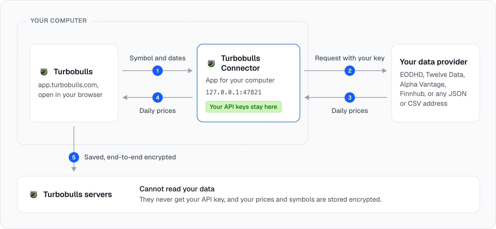

<p align="center">
  
</p>

<h1 align="center">Turbobulls Connector: app for your computer</h1>

<p align="center">
  <strong>Prices from your own market-data subscription, for <a href="https://turbobulls.com">Turbobulls</a>.</strong><br>
  A small program on your own computer, for Firefox or any browser. Your key goes only to your provider, and Turbobulls cannot read your data.
</p>

<p align="center">
  <a href="https://github.com/turbobullsapp/turbobulls-bridge/actions/workflows/ci.yml"></a>
  <a href="LICENSE"></a>
  
  
  <a href="https://www.npmjs.com/package/turbobulls-bridge"></a>
  <a href="https://scorecard.dev/viewer/?uri=github.com/turbobullsapp/turbobulls-bridge"></a>
</p>

<p align="center">
  <a href="#quick-start">Quick start</a> ·
  <a href="#use-it-in-turbobulls">Use it in Turbobulls</a> ·
  <a href="#privacy-and-security">Privacy and security</a> ·
  <a href="docs/custom-sources.md">Your own sources</a> ·
  <a href="#troubleshooting">Troubleshooting</a> ·
  <a href="#development">Development</a> ·
  <a href="CHANGELOG.md">Changelog</a>
</p>

---

If you pay for a market-data provider, the Turbobulls Connector app lets Turbobulls price the
assets it does not cover with that provider's data. It runs on your own computer, listens only
there, and asks your provider with your own key; Turbobulls receives the daily prices, never the key.

It is the Turbobulls Connector as a program, run with the `turbobulls-bridge` command: for Firefox,
and for anyone who prefers a program to a browser extension. In Chrome and Edge, the
[Turbobulls Connector extension](https://github.com/turbobullsapp/turbobulls-extension) does the same
job with nothing to keep running.

> [!NOTE]
> **Nobody else sees your key or your data.** Your API keys stay on this computer and go only to
> your providers. Turbobulls never receives them and cannot read your data: the prices, and which
> assets you price, are saved end-to-end encrypted with the rest of your portfolio. See
> [who sees what](#who-sees-what) below.

## Highlights

- **Your key stays on your computer**, in a config file only you can read, and goes only to its own
  provider.
- **Turbobulls cannot read your data.** The prices, and which assets you price, are saved
  end-to-end encrypted with the rest of your portfolio.
- **Reachable from your computer only.** It listens on `127.0.0.1` and answers only
  `https://app.turbobulls.com`; any other website, and any request without the app's address, is
  refused.
- **Never fetches an address it is given.** It reaches your provider's API and the sources you
  configured, nothing else, and never follows a redirect.
- **No dependencies.** Node.js built-ins only; also available as a container image.
- **Four providers built in**, plus [sources of your own](docs/custom-sources.md) that answer JSON or
  CSV.

## How it works

<p align="center">
  <picture>
    <source media="(prefers-color-scheme: dark)" srcset="docs/images/how-it-works-dark.png">
    
  </picture>
</p>

The app and the Connector speak a small, documented protocol (`hello`, `search` and `history`); see
[PROTOCOL.md](PROTOCOL.md). Turbobulls keeps the prices in your workspace, end-to-end encrypted, so
your other devices (your phone included) receive them with the app's normal sync.

## Requirements

- [Node.js](https://nodejs.org) 22 or newer, or Docker.
- An API key from at least one provider:

| Provider | Key variable | Covers | Notes |
|---|---|---|---|
| [EODHD](https://eodhd.com) | `EODHD_API_KEY` | Stocks, ETFs and funds on most exchanges | |
| [Twelve Data](https://twelvedata.com) | `TWELVEDATA_API_KEY` | Stocks, ETFs, forex and crypto | Showing prices needs a paid plan |
| [Alpha Vantage](https://www.alphavantage.co) | `ALPHAVANTAGE_API_KEY` | Stocks and ETFs | The free plan allows few requests a day |
| [Finnhub](https://finnhub.io) | `FINNHUB_API_KEY` | Stocks | Daily prices need a paid plan |

What you can price depends on your plan with the provider.

EODHD, Twelve Data, Alpha Vantage and Finnhub are named only to show which services the Connector
can ask with your own key. Turbobulls is not affiliated with or endorsed by any of them, and your use
of each one is under your own plan and its terms.

## Quick start

1. **Create the config file** for your keys. It is made readable only by you:

   ```bash
   npx turbobulls-bridge@1.0.0 init
   ```

2. **Add your key.** Open the file it names (`~/.config/turbobulls-bridge/config.json` on macOS and
   Linux, `%LOCALAPPDATA%\turbobulls-bridge\config.json` on Windows) and paste your key next to your
   provider:

   ```json
   { "keys": { "eodhd": "your-key-here", "twelvedata": "", "alphavantage": "", "finnhub": "" } }
   ```

3. **Check it and start it.** Leave it running while you use Turbobulls:

   ```bash
   npx turbobulls-bridge@1.0.0 test
   npx turbobulls-bridge@1.0.0
   ```

> [!TIP]
> Always name the version (`@1.0.0`), so `npx` runs exactly the release you chose. Keys can also be
> environment variables (`EODHD_API_KEY` and the others above); a variable wins over the file.
> Restart the Connector app after editing the file.

### With Docker

Put your keys in a file only you can read, one per line (`EODHD_API_KEY=your-key`), then:

```bash
chmod 600 ~/.config/turbobulls-bridge/bridge.env
docker run --rm \
  -p 127.0.0.1:47821:47821 \
  --env-file ~/.config/turbobulls-bridge/bridge.env \
  ghcr.io/turbobullsapp/turbobulls-bridge:1.0.0
```

> [!WARNING]
> - Keep `127.0.0.1:` in front of the port. Without it (or with `-P`), Docker opens the Connector to
>   your whole network, past most firewalls, and anyone on it could use your keys.
> - Never run it with `--network host`: the container then shares the computer's network, the port
>   setting no longer applies, and the Connector is open to your whole network the same way.
> - Keep the port 47821: the app only looks there.
> - Do not write a key on the `docker run` command line (`-e EODHD_API_KEY=...`): other users of the
>   computer can read command lines, and your shell keeps them in its history.

## Use it in Turbobulls

1. In Turbobulls, open **Settings > Custom data sources** and turn on **Use the Connector app on this
   device**. The browser asks once whether Turbobulls may reach your local network: allow it, since
   the Connector runs on your own computer.
2. Add a custom asset, choose **From a custom data source**, search for the symbol and pick it.

Turbobulls refreshes linked prices while the app is open on a computer running the Connector app,
and your other devices receive them through the app's encrypted sync.

**Browsers:** Chrome, Edge and Firefox. Safari does not let a secure website talk to a program on
your computer, so the Connector app does not work there.

## Your own sources

For prices none of the four providers carry (a pension fund's daily price, a small exchange, a
spreadsheet you publish yourself), add a source to the `sources` list in the config file: any
`https://` address that answers JSON or CSV, with placeholders for the symbol and the dates.

```json
{
  "sources": [
    {
      "id": "mypension",
      "name": "My pension fund",
      "url": "https://api.example.com/funds/{SYMBOL}/prices?from={FROM}&to={TO}",
      "format": "json",
      "json": { "items": "data.prices", "date": "day", "close": "nav" },
      "currency": "EUR"
    }
  ]
}
```

Every setting, the answer shapes it reads and the rules it keeps are in
**[docs/custom-sources.md](docs/custom-sources.md)**.

## Commands

With `npx`, write `npx turbobulls-bridge@1.0.0` where these say `turbobulls-bridge`.

| Command | What it does |
|---|---|
| `turbobulls-bridge` | Start the Connector app |
| `turbobulls-bridge init` | Create the config file for your keys |
| `turbobulls-bridge test` | Check each key, and each source of your own, with one small request |
| `turbobulls-bridge --help` | Show every option |

Environment variables besides the keys: `TURBOBULLS_BRIDGE_CONFIG` (the config file to read), and
`TURBOBULLS_BRIDGE_HOST` and `TURBOBULLS_BRIDGE_PORT` (the container image sets these; leave them
alone otherwise).

## Privacy and security

### Who sees what

| | Your API key | Which assets you price | Your prices and portfolio |
|---|---|---|---|
| **Turbobulls' servers** | Never receive it | Cannot see them: stored encrypted | Cannot read them: stored encrypted |
| **The Connector app** | Keeps it on this computer, and sends it only to your provider | Only the ones Turbobulls asks it to fetch | Passes the prices on; cannot read your portfolio |
| **Your data provider** | Checks it, as on any call to its API | Each symbol it is asked for | Sends the prices; never sees your portfolio |

The Turbobulls app decrypts your data in your browser, on your device: your portfolio and the
prices leave it only end-to-end encrypted.

### What the program can do

- **It only reaches** your provider's API (`eodhd.com`, `api.twelvedata.com`,
  `www.alphavantage.co`, `finnhub.io`) and the sources you add yourself, and only when the
  Turbobulls app asks for a search or for prices.
- **It only listens on `127.0.0.1`**, so nothing outside your computer can reach it, and it checks
  the address a request was sent to, so a web page cannot reach it through a trick of its domain
  name.
- **It only answers `https://app.turbobulls.com`.** Any other website, and any request without the
  app's address, is refused.
- **It never accepts a web address to fetch**, so it cannot be used to reach anything else, and it
  never follows a redirect.
- **It never writes your key** into a log line, an error or an answer to the app.

Found a security problem? Please report it privately, as described in [SECURITY.md](SECURITY.md).

## Troubleshooting

<details>
<summary><strong>"Port 47821 is already in use"</strong></summary>

The Connector app is probably already running in another window.
</details>

<details>
<summary><strong>"The Connector did not answer"</strong></summary>

Check that the Connector app is running, that **Use the Connector app on this device** is on in
Turbobulls, that you allowed local network access when the browser asked, and that nothing else (a
VPN, a firewall) blocks `127.0.0.1:47821`.
</details>

<details>
<summary><strong>"EODHD refused the key in the Connector"</strong></summary>

Run `turbobulls-bridge test` to check each key with one small request, and compare the key with the
one in your provider's dashboard. After fixing it in the config file, restart the Connector app.
</details>

<details>
<summary><strong>"Your EODHD plan does not include ..."</strong></summary>

Your plan with the provider does not cover that symbol, or not that much history.
</details>

## Development

```bash
pnpm install
pnpm check        # typecheck, lint, test and build
pnpm dev          # start the Connector app, also answering http://localhost:3000
```

The provider code in `src/shared/` is identical in the
[extension](https://github.com/turbobullsapp/turbobulls-extension); a change there is made in both.
Releases, and how to check one, are described in [RELEASING.md](RELEASING.md); every change is in
[CHANGELOG.md](CHANGELOG.md).

## Contributing

Issues and pull requests are welcome. Please read [CONTRIBUTING.md](CONTRIBUTING.md) first, and
report security problems privately as described in [SECURITY.md](SECURITY.md).

## License

The code is released under the [MIT License](LICENSE) © Turbobulls.

The Turbobulls name and logo are not covered by that license. If you publish a copy of the
Connector app, give it its own name and icon.
